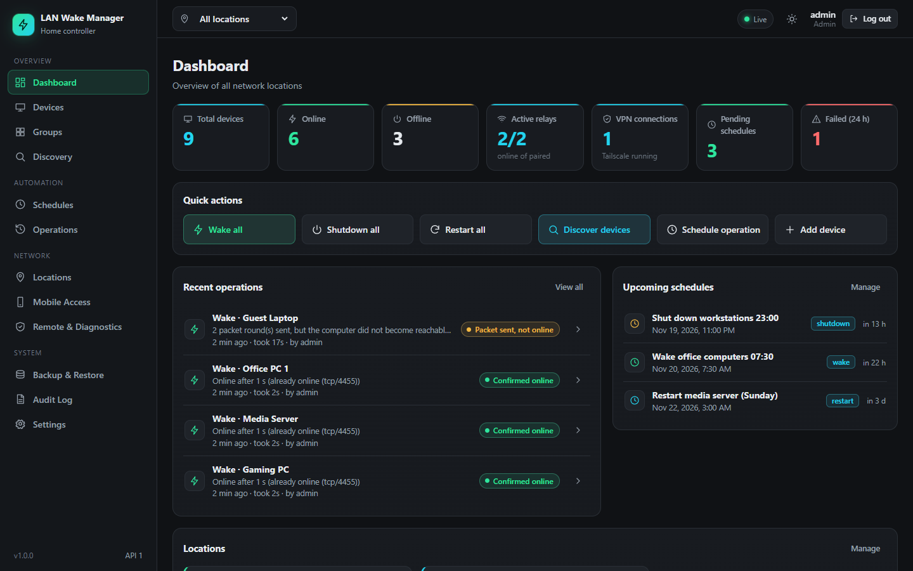
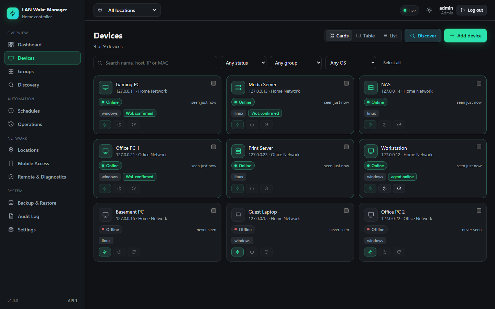
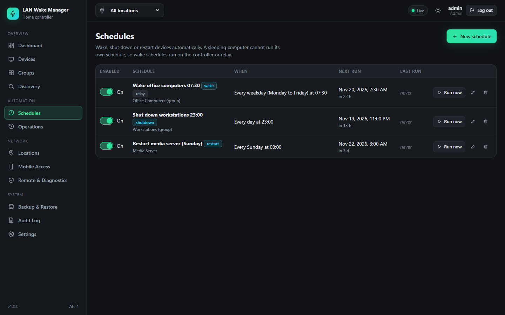
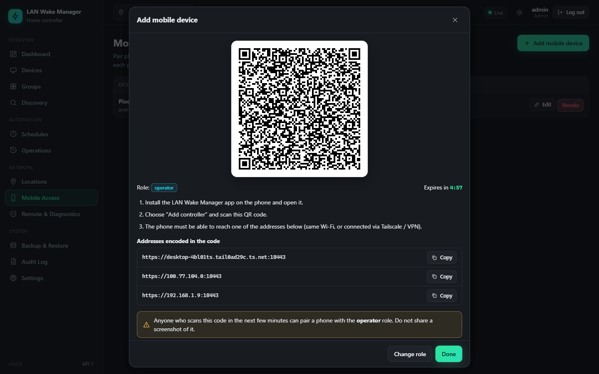
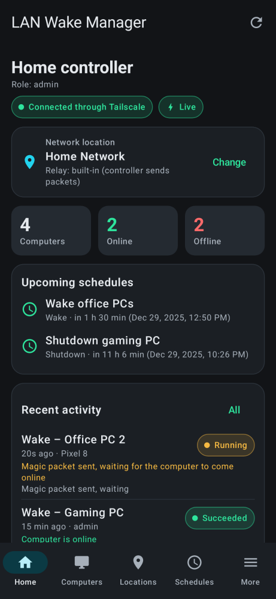
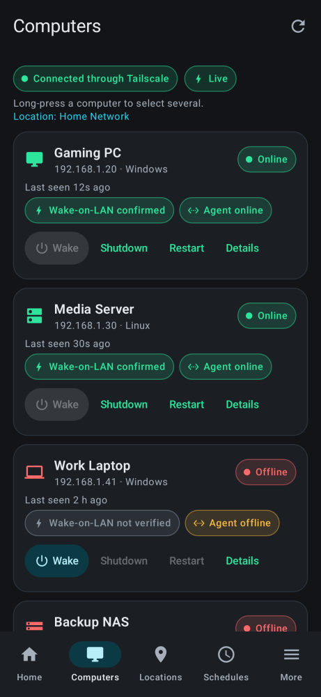
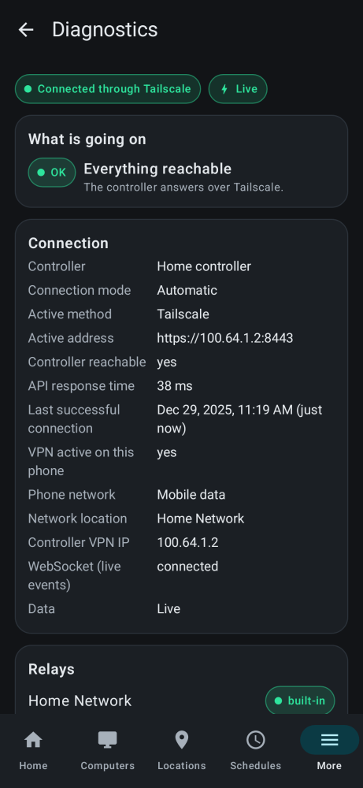
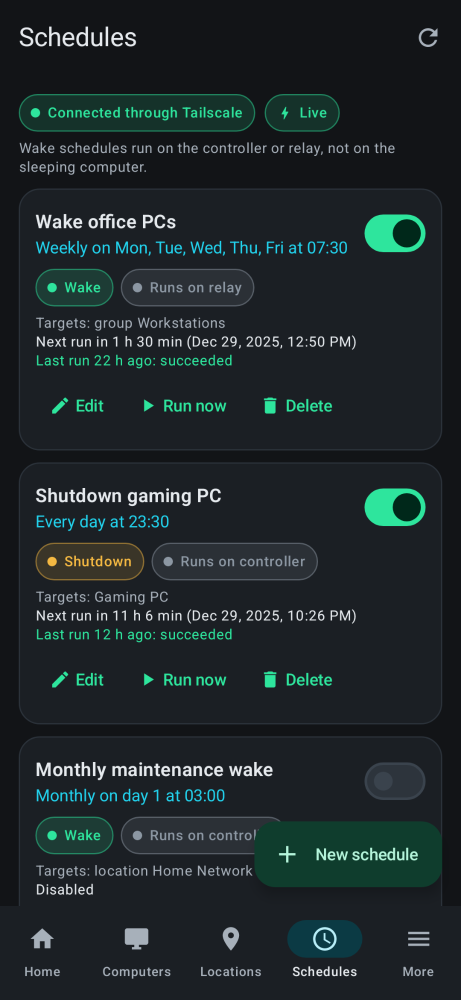

# LAN Wake Manager

**Wake, shut down and restart your computers from your phone — from anywhere in the world.**
A local-first, self-hosted remote power manager for Windows and Linux with a native Android app. Remote access runs through your own
**Tailscale** or **WireGuard** VPN; a small **Wake Relay** inside each LAN sends the Wake-on-LAN packets, and the app only reports success when the computer really came up.



## What you get

| Component | Platforms | Role |
|---|---|---|
| **Controller** | Windows service, Linux systemd | Always-on brain: device inventory per network location, schedules, monitoring, REST/WebSocket API, audit log, backups, built-in relay for its own LAN |
| **Dashboard / desktop app** | Windows, Linux (Tauri window) and any browser | Devices, groups, discovery, schedules, QR pairing, diagnostics, backup |
| **Android app** | Android 8+ (Kotlin, Jetpack Compose) | The remote control panel: wake / shutdown / restart, locations, groups, schedules, history, diagnostics, local notifications |
| **Wake Relay** | Windows service, Linux systemd | Sits in each other LAN (office…), sends magic packets locally and verifies start-up |
| **Agent** | Windows service, Linux systemd | Reports CPU/RAM/disks/uptime, executes graceful shutdown/restart (delayed + cancel) |

Highlights

* **Remote everywhere**: Tailscale (detected and shown), self-hosted WireGuard profiles, direct LAN; connection modes *Automatic / VPN only / LAN only*; the app always shows how it is connected and never silently falls back to an insecure route.
* **Honest Wake-on-LAN**: broadcast on the right interfaces, UDP 9 + 7, retries, timeout, **success only after the computer answers** (ping/TCP or agent heartbeat). A sent packet alone is reported as *timeout*.
* **Multiple locations**, each with its own devices and relay; relay-run wake schedules that keep working when the controller is down.
* **Shutdown / restart** via agent, SSH keys or WinRM; bulk actions need explicit confirmation.
* **Secure by design**: QR pairing with short-lived single-use tokens, certificate pinning, roles (viewer/operator/admin), per-phone revocation, rate limiting, audit log, API reachable only from private/VPN addresses, no arbitrary command execution. See [docs/SECURITY.md](docs/SECURITY.md).
* **Persistent automation**: one-time/daily/weekly/monthly/custom schedules, start/end dates, exceptions, missed-run policy, retries, no duplicate runs.
* **Backups**: automatic + manual SQLite backups, restore, JSON export/import without secrets.

| Devices | Schedules | Mobile pairing |
|---|---|---|
|  |  |  |

| Android: Home | Computers | Diagnostics | Schedules |
|---|---|---|---|
|  |  |  |  |

More: [locations](docs/screenshots/desktop-locations.png), [remote access](docs/screenshots/desktop-remote-access.png), [history](docs/screenshots/desktop-history.png), [groups](docs/screenshots/desktop-groups.png), [backup](docs/screenshots/desktop-backup.png), [audit log](docs/screenshots/desktop-audit.png). *The desktop screenshots come from the real software running on loopback with simulated computers; the Android screenshots are rendered on the JVM with sample data.*

## Download

[**Releases**](https://github.com/unupunct/LAN-Wake-Manager/releases/latest):

| File | For |
|---|---|
| `LAN-Wake-Manager-Setup.msi` | Windows controller + desktop window |
| `LAN-Wake-Manager-Relay-Setup.msi` | Windows Wake Relay |
| `LAN-Wake-Manager-Agent-Setup.msi` | Windows agent |
| `lan-wake-manager-controller_*.deb`, `…-relay_*.deb`, `…-agent_*.deb` | Debian/Ubuntu services (systemd) |
| `LAN-Wake-Manager-x86_64.AppImage`, `lan-wake-manager-desktop_amd64.deb` | Linux desktop window |
| `LAN-Wake-Manager.apk` | Android app (signed release build) |

## Quick start (about 10 minutes)

1. Install the **controller** on an always-on computer ([Windows](docs/INSTALL-WINDOWS.md) · [Linux](docs/INSTALL-LINUX.md)) and set the admin password in the dashboard.
2. Install **Tailscale** on the controller and your phone ([guide](docs/guides/01-tailscale.md)) — or use [WireGuard](docs/guides/02-wireguard.md).
3. Dashboard → *Devices → Add device* (or *Discovery*): name, **MAC address**, IP. Configure Wake-on-LAN on the computer ([guide](docs/guides/05-wake-on-lan.md)).
4. Install the **Android app**, *Mobile Access → Add mobile device* in the dashboard, scan the QR ([guide](docs/guides/03-android.md)).
5. Press **Wake**. For shutdown/restart install the **agent** on the computer ([guide](docs/guides/06-remote-power.md)). More LANs: install a **relay** there ([guide](docs/guides/04-relay.md)).

All guides: [Tailscale](docs/guides/01-tailscale.md) · [WireGuard](docs/guides/02-wireguard.md) · [Android](docs/guides/03-android.md) · [Relay](docs/guides/04-relay.md) · [Wake-on-LAN setup](docs/guides/05-wake-on-lan.md) · [Remote shutdown prerequisites](docs/guides/06-remote-power.md) · [Troubleshooting](docs/guides/07-troubleshooting.md) · [Architecture](docs/ARCHITECTURE.md) · [API](docs/API.md) · [Security](docs/SECURITY.md)

## Building from source

```bash
(cd ui && npm ci && npm run build)          # dashboard (embedded into the controller)
cargo build --release                       # controller, relay, agent
cargo test --workspace                      # unit tests
python tools/e2e.py                         # real controller + relay + agent processes on loopback (needs `cargo build` first)
(cd desktop/src-tauri && cargo build --release)       # desktop window
powershell -ExecutionPolicy Bypass -File tools/build-windows.ps1   # the three MSIs (needs WiX v5)
(cd android && ./gradlew assembleRelease)   # APK (JDK 17 + Android SDK)
```
Linux packages are produced by the `Linux packages` GitHub Actions workflow (see `.github/workflows`).

## What has and has not been verified

Verified in this repository (see CI and the test suites):

* 31 core unit tests, 64 end-to-end checks with **real controller, relay and agent processes** (pairing, pinned TLS, role enforcement, wake success *and* honest timeout, relay pairing/failure, discovery, agent enrollment and command execution in dry-run, schedules firing, backup/restore, export without secrets, revocation, rate limiting, WebSocket auth, audit log); dashboard tests (21) and a browser run of every page against the real controller; Android: 89 JVM tests including pinned-TLS and a pairing run against a real controller.
* Windows: services, MSIs built; desktop window launched against its private controller.

**Not verified** (be aware before you rely on it):

* Wake-on-LAN against real sleeping hardware (packet construction/transmission and the verify-by-reachability logic are tested; BIOS/NIC behaviour depends on your machines).
* The Android app has **never run on a real device or emulator** (none was available): camera/QR scanning, biometric lock, notifications, WorkManager and VPN transitions are unverified. Core networking and screens are covered by JVM tests/renders.
* Windows MSI installation (services, firewall rule, upgrade/uninstall) was built but not installed in the development environment; Linux `.deb`/AppImage are built and smoke-tested by CI on Ubuntu 22.04 only.
* Real Tailscale/WireGuard setups (Tailscale status parsing is unit-tested), SSH and WinRM power-off against real hosts (command construction and validation are tested), Raspberry Pi/arm64 builds.
* Installers are not code-signed.

## License

MIT — see [LICENSE](LICENSE).
